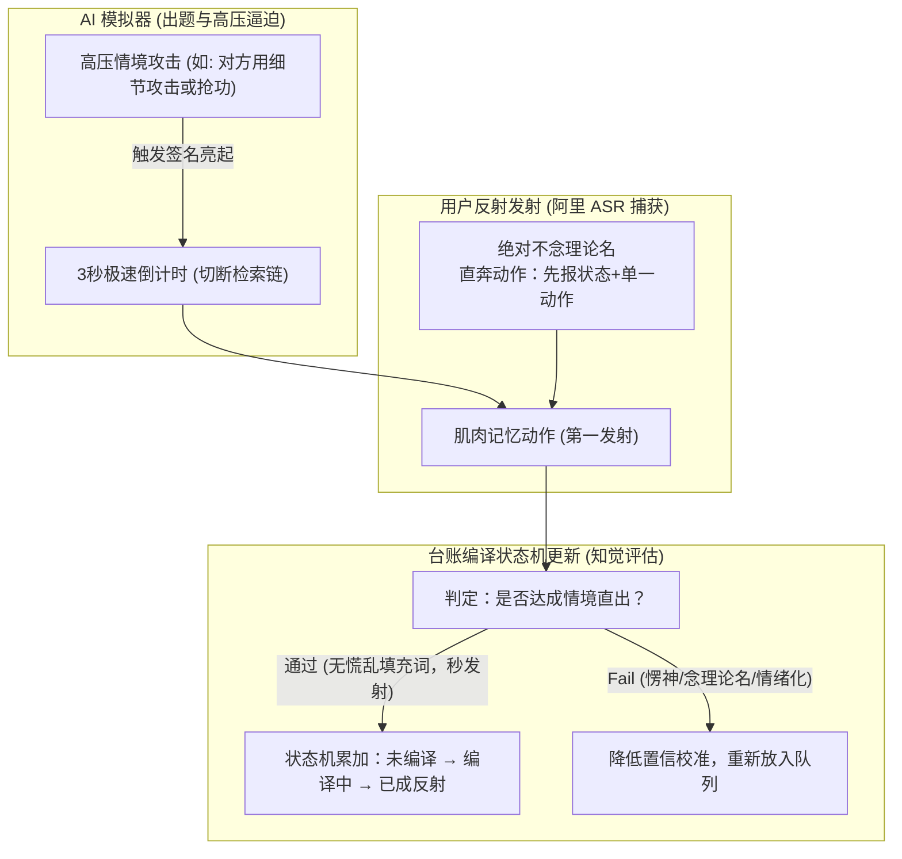

# 反射训练台账与高压表达系统的深度融合方案

> **核心宗旨**：将 `反射训练台账.md` 中的理论与决策防线，编译成在被攻击、被否定、高压质问时**无需检索脑内理论名、瞬间即可秒发射的肌肉记忆（System 1 物理反射）**。

---

## 1. 为什么这两者是“天作之合”？

在 `反射训练台账.md` 中，提出了一个极其深刻的技能训练法则：
> **“刷的正确方向：遮住条目名，只看【触发签名】，直接【第一发射】。能立刻说出理论名 = 还在走检索链（Fail）；情境亮出直接做动作，事后才反应过来 = 已成反射。”**

而在我们的 **【高压对抗表达系统】** 中，正好提供了：
1. **完全解耦的学习装置 (安全沙箱)**：对应台账第 47 条（*误差信号与惩罚信号解耦*），在模拟器里高频犯错没有任何真实惩罚，样本量可以暴涨 100 倍。
2. **先判后揭的逼练机制**：对应台账第 48 条（*知觉养成协议*），AI 攻击出来后，强制倒计时，逼您在没有资料、没有犹豫时间的情况下直接出拳（第一发射）。

---

## 2. 融合后的“高压反射训练场”工作流

---

## 3. 台账条目在【高压表达系统】中的实战映射表

我们可以直接把《反射训练台账》中的强制队列条目，转化为具体的**高压表达对练关卡**：

| 台账条目 | 触发签名 (AI 攻击/质问情境) | 训练要求的“第一发射动作” | 判定 Pass 标准 |
| :--- | :--- | :--- | :--- |
| **#1 分层收敛** | 对方在高压下用大量细节、多变量淹没你，追问：“这到底怎么办？” | **先报状态名 + 单一动作，再分析原因**。 （绝对不进入泥潭解释细节） | 1 秒内开始开口，先动作后解释，顺序锁死。 |
| **#5 阀门解耦** | 对方态度极其恶劣、对你进行人身攻击或情绪化辱骂 | **隔断：感知照常，行动由判断驱动**。 （冷静识别意图，不被对方情绪带偏） | 0 慌乱口头禅（如“额”、“你凭什么”），语音语调平稳。 |
| **#6 敞口制造** | 对方信息不全、全凭猜测质问：“你是不是根本没准备好？” | **停推演，制造敞口**：“我们用两分钟去拿真实数据/看一眼，用事实说话。” | 止住无意义辩解，发出一句拿真实反馈的动作命令。 |

---

## 4. 系统实现路径

1. **台账条目导入**：读取 `反射训练台账.md` 中的“触发签名”和“第一发射（可背的一行）”，自动生成 AI 模拟者的Prompt攻击词。
2. **极速 ASR 响应检测**：利用阿里 FunASR 实时计算从 AI 发言结束到您开始开口的 **VAD 时延（Voice Activity Detection）**，超过 2.5 秒即判为“走脑内检索链 (Fail)”。
3. **反射状态机联动**：训练完成后，系统可自动为您更新 `反射训练台账.md` 里的【状态】与【连续通过次数】（如未编译 → 编译中 → 已成反射）！
