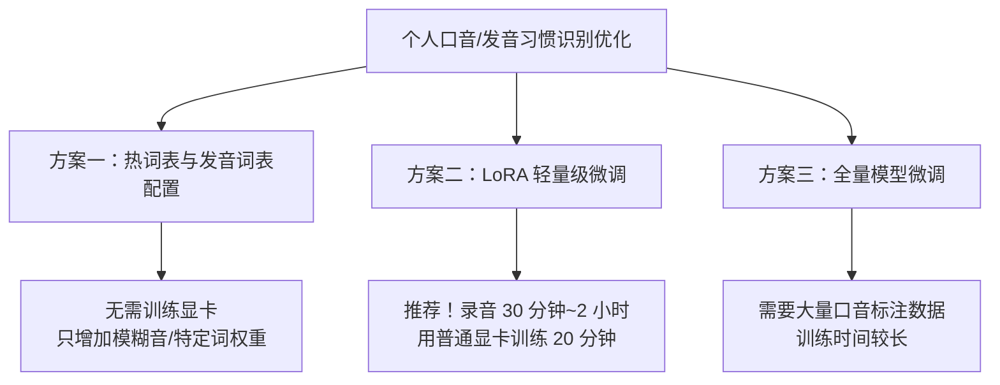

# 个人专属语音识别模型 (ASR) 二次训练与口音微调指南

## 1. 能不能针对个人口音 (如 L/N、In/Ing 不分) 进行二次训练？

答案是：**完全可以！而且效果非常显著！**

针对个人口音特点（如 L/N 发音混淆、前后鼻音不分、特定行业术语），通过您自己的声音进行**模型微调 (Fine-tuning)**，可以将您个人的识别准确率提升 **30% ~ 50% 以上**。

---

## 2. 有哪些开源模型可以自己二次训练/调教？

### 阿里巴巴达摩院 FunASR (推荐)
- **开源地址**：[阿里巴巴 FunASR 社区](https://github.com/modelscope/FunASR)
- **特点**：本项目使用的 **Paraformer** 以及阿里最新的 **SenseVoice** 模型全套开源。
- **微调支持**：FunASR 官方提供了完整的训练、微调（Fine-Tuning）、LoRA 微调脚本。
- **导出能力**：微调后可以直接导出为 ONNX 格式，然后打包替换本项目 `models/` 目录中的文件，软件就能变成**为您个人专属定制的识别系统**。

### OpenAI Whisper 系列 (Faster-Whisper)
- **特点**：支持通过 LoRA（轻量级微调）对 Whisper-base / Whisper-small 进行个人口音自适应训练。

---

## 3. 针对个人特点“调教”模型的 3 种方案 (由易到难)

### 方案一：热词表与模糊音配表 (最简单，无需训练)
- **原理**：直接在解码层配置“拼音模糊音规则”（如设置 l ↔ n 互换，in ↔ ing 偏置）和专有名词热词表。
- **优点**：不需要任何显卡和重新训练模型，改配置即生效。

### 方案二：LoRA 轻量微调 (最推荐，效果最好)
- **准备数据**：用手机或电脑录制约 **30 分钟 ~ 1 小时** 您自己的朗读语音（约 300 句包含 L/N、In/Ing 的句子），并附上对应的标准文本。
- **训练设备**：一张普通的 NVIDIA 显卡（如 RTX 3060/4060）或免费的 Google Colab。
- **步骤**：
  1. 克隆 阿里 `FunASR` 仓库；
  2. 将您的录音和文本放入训练集格式中；
  3. 运行 `finetune.py` (LoRA 微调)；
  4. 导出成 ONNX 文件并用 `sherpa-onnx` 量化成 `encoder.int8.onnx`；
  5. 替换本项目中的模型文件。

---

## 4. 总结

您完全可以利用阿里开源的 **FunASR** 框架，用您自己的录音对 Paraformer 或 SenseVoice 模型进行 **LoRA 微调**。训练出来的专属模型体积依然只有几百兆，且能完美识别您的特定发音习惯！
