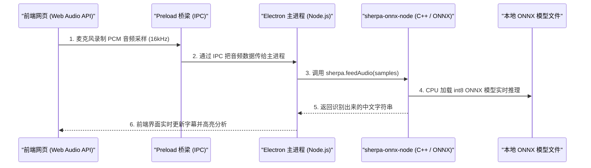

# 宇宙无敌表达训练系统 (`expression-trainer`) 语音技术架构全解

## 1. 项目的核心特点与区分

这个项目的核心功能是 **语音识别 (ASR)**，也就是把您说的话实时转换成文字，然后对文字进行“表达习惯”（如口头禅、含糊词、表达密度）的实时分析。

| 功能 | 技术类型 | 本项目采用的技术方案 | 是否需要下载模型 | 是否需要 API 密钥/联网 |
| :--- | :--- | :--- | :--- | :--- |
| **语音识别** (听您说话转文字) | **ASR** (Speech-to-Text) | **阿里开源 Paraformer 轻量化模型** + **`sherpa-onnx-node` 推理引擎** | **是** (存在于 `models/` 目录下) | **否** (纯 CPU 本地离线识别，极快且准) |
| **语音朗读** (文字读给您听) | **TTS** (Text-to-Speech) | **Web Speech API** (`window.speechSynthesis`) | **否** | **否** (直接调用 Windows/macOS 系统原生语音) |

---

## 2. 为什么感觉“没有模型”却识别得特别准？

您之前觉得“没有模型”是因为它既没有部署昂贵的 GPU 服务器，也没有调用 API，而且软件启动极快。

其实它**确实使用了模型**，只不过这是一个非常优秀的**端侧轻量小模型**：

1. **模型来源**：
   使用了阿里达摩院开源的 **Paraformer 双语 (中英文) 实时语音识别模型**。
2. **小模型的秘诀（INT8 量化技术）**：
   这个模型经过了 `INT8` 量化压缩（压缩后文件名为 `encoder.int8.onnx` 和 `decoder.int8.onnx`），体积极小（几十到上百兆），但保留了 95% 以上的高精准度！
3. **推理引擎框架 (`sherpa-onnx`)**：
   由新一代开源语音框架 `sherpa-onnx` 提供支持。它专门为 CPU 端侧推理优化，极其节省 CPU 和内存。

---

## 3. 这个模型是怎么在 Electron 架构里运行起来的？

架构调用链如下：

- **前端 (Chromium)**：只负责从麦克风采集声音数据（Web Audio API）并实时渲染高亮字幕。
- **桥梁 (Preload / IPC)**：把音频数据安全高效地传给后台。
- **后台 (Node.js + C++ 插件)**：通过 `sherpa-onnx-node` 插件直接在本地 CPU 上加载 `models/` 目录下的 ONNX 文件运行推理。

---

## 4. 总结

1. **语音朗读 (TTS)**：不需要模型也不用 API，JS 直接调**操作系统**（Windows 晓晓语音/SAPI）。
2. **语音识别 (ASR)**：靠的是 Electron 后台加载的 **阿里 Paraformer INT8 本地小模型**，借助 **`sherpa-onnx`** 引擎在 CPU 上离线跑，所以识别既准确又不需要联网！
