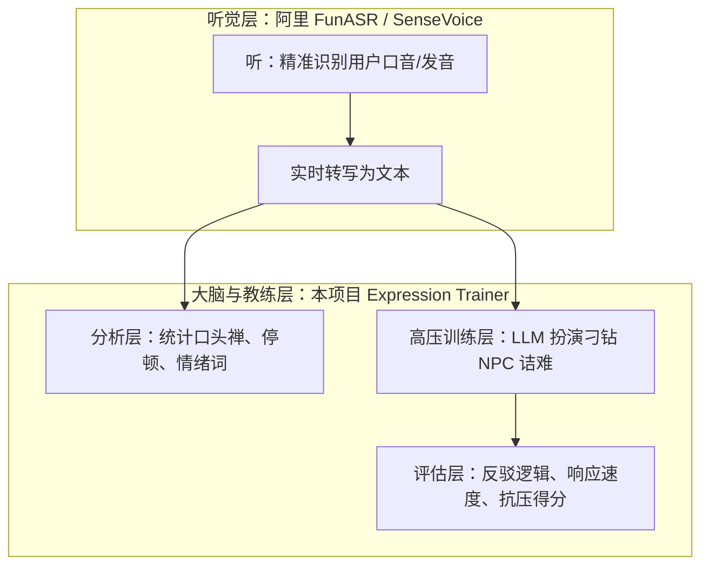
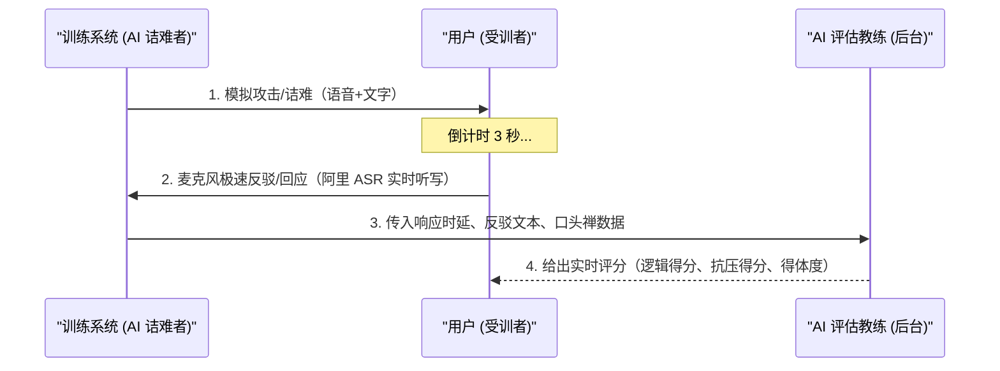

# 高压对抗应变表达训练系统 (Expression Trainer Pro) 扩展方案

## 1. 阿里开源 ASR 与本项目的分工与结合

这两个项目结合起来是一个极其完美的**“耳朵 + 大脑”架构**：

- **阿里开源项目 (FunASR/SenseVoice)**：充当“**耳朵**”。负责把您带有口音的、快速说出的语音，百分之百准确地转写成文本。
- **本项目 (`expression-trainer`)**：充当“**大脑与教练**”。负责分析您的表达缺陷，并构建“高压情境对练场”。

---

## 2. “高压对抗与快速响应训练”场景设计

完全可以基于本项目扩展出一个全新的 **【高压对抗模拟器】(Stress Response Simulator)** 模式：

### 核心训练维度：

1. **响应速度 (Reaction Latency)**：
   - 设定 3 秒/5 秒倒计时。要求在别人表达攻击后，必须在规定时间内立刻开口，训练直觉反应能力。
2. **高压情绪管理 (Emotional Control)**：
   - 检测您在被辱骂或否定时，是否出现大量“额...这个...”、“就是说”等慌乱填充词。
3. **金字塔反驳逻辑 (Logical Counter)**：
   - 评估您是“情绪化回骂”还是“优雅有力的事实反驳”（如：认同情绪 -> 纠正事实 -> 提出方案）。

---

## 3. 具体可以训练哪些场景？

| 训练场景 | AI NPC 角色风格 | 训练目标 |
| :--- | :--- | :--- |
| **职场被否定/抢功** | 强势的上级或刁钻的同事 | 练习不卑不亢、用数据和事实优雅反击 |
| **突发人身攻击/辱骂** | 情绪失控的客户或挑衅者 | 练习冷静化解、建立心理防线与高情商怼回 |
| **高压面试/质询** | 严苛的面试官或审计人员 | 练习高压下的逻辑严密性与自信表达 |

---

## 4. 总结

完全可行！这赋予了本项目巨大的 practical 价值。
从单纯的“口语习性纠正”，升级为**“高压情绪管理与极速对答应变训练营”**。阿里 FunASR 负责听得准，本项目负责考得严！
